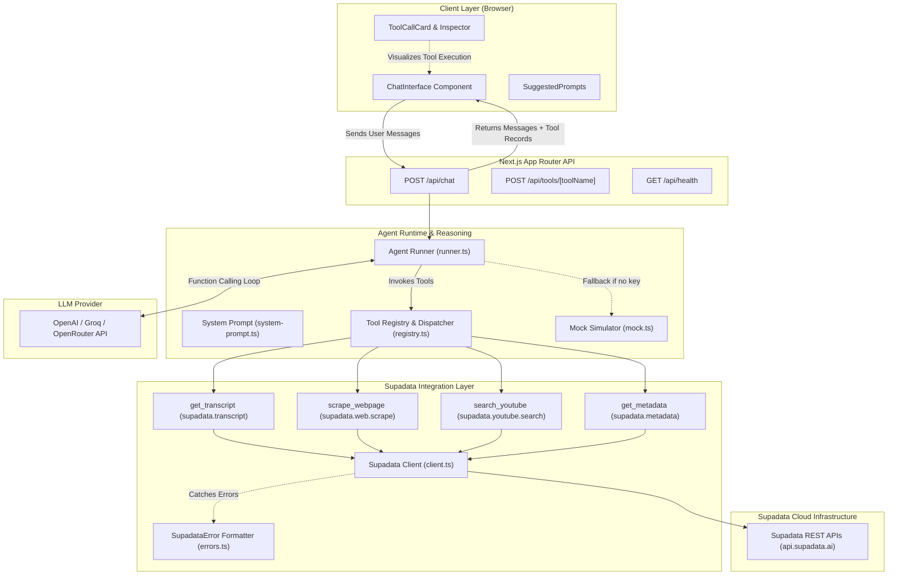

# Supa Agent Starter ⚡🤖

[](https://github.com/supadata-ai/supa-agent-starter/actions/workflows/ci.yml)
[](https://www.npmjs.com/package/@supadata/js)
[](https://nextjs.org/)
[](https://www.typescriptlang.org/)
[](./LICENSE)

**Supa Agent Starter** is a production-ready, open-source AI Agent template and starter kit built with **Next.js (App Router)**, **TypeScript**, **Tailwind CSS**, and the official [**Supadata SDK** (`@supadata/js`)](https://supadata.ai).

It provides an end-to-end reference implementation demonstrating how to build autonomous, multi-turn AI agents that interact with external video platforms and the live web using LLM tool calling (function calling).

---

## 🌟 Why Supa Agent Starter?

Most AI agents are confined to static knowledge bases or hallucinate when asked about video content, contemporary tutorials, or live documentation.

**Supadata** bridges this gap by acting as high-speed data infrastructure for AI applications. With Supa Agent Starter, your conversational agent gains instant real-world capabilities:

- 🎬 **Video Intelligence**: Extracts timestamped or continuous transcripts across YouTube, TikTok, Instagram, and Twitter/X videos without browser automation or brittle scrapers.
- 🌐 **Web to Clean Markdown**: Converts full web pages, articles, and technical docs directly into LLM-optimized Markdown while stripping irrelevant DOM elements.
- 🔍 **YouTube Discovery**: Searches videos, playlists, and channels with granular filters (upload date, duration, relevance, view counts).
- 📊 **Social Metadata & Metrics**: Extracts structured engagement analytics (views, likes, comments, author profiles) for social media media.
- ⚡ **Interactive Developer Experience**: Built-in interactive tool cards with execution timers, raw JSON inspection, copyable payloads, and an offline simulation mode.

---

## 📑 Table of Contents

- [Features](#-features)
- [Architecture Overview](#-architecture-overview)
- [How the Supadata SDK is Used](#-how-the-supadata-sdk-is-used)
- [Repository Structure](#-repository-structure)
- [Prerequisites](#-prerequisites)
- [Quickstart & Installation](#-quickstart--installation)
- [Environment Configuration](#-environment-configuration)
- [Example Agent Interactions](#-example-agent-interactions)
- [Agent Tools Reference](#-agent-tools-reference)
- [API Endpoints](#-api-endpoints)
- [Running Tests & Quality Checks](#-running-tests--quality-checks)
- [Deployment Guide](#-deployment-guide)
- [Troubleshooting & FAQs](#-troubleshooting--faqs)
- [Contributing](#-contributing)
- [License](#-license)

---

## 🚀 Features

| Feature | Description |
| :--- | :--- |
| **Autonomous Tool Calling** | Multi-turn reasoning loop where the agent detects intent, calls Supadata SDK methods, inspects results, and synthesizes answers. |
| **Official Supadata SDK** | Strict typing and real-world method integration with `@supadata/js` v1.4.0. |
| **Server-Side Security** | API keys (`SUPADATA_API_KEY`, `OPENAI_API_KEY`) stay strictly on the server; client never has access to credentials. |
| **Modern Chat UI** | Sleek dark-mode interface built with Tailwind CSS, custom scrollbars, and Lucide icons. |
| **Live Tool Execution Cards** | Collapsible cards displaying tool name, latency in milliseconds, status badges, and expandable JSON input/output viewers. |
| **Zero-Config Demo Mode** | Works out of the box with deterministic mock simulation even before setting up external API keys. |
| **Provider Agnostic** | Standard OpenAI-compatible integration — works with OpenAI, Groq, OpenRouter, Together, or local Ollama instances. |
| **Async Job Polling** | Automatic handling and polling for long video transcription jobs via `supadata.transcript.getJobStatus`. |
| **Full Test Suite** | 30+ unit and integration tests powered by Vitest, with 100% typecheck and ESLint compliance. |

---

## 🏗 Architecture Overview

The application follows a clean layered architecture, strictly separating the user interface, agent reasoning engine, tool dispatching layer, and the official Supadata SDK:



### Flow Lifecycle:
1. **User Request**: User sends a prompt or URL (e.g., *"Summarize this YouTube video: https://..."*).
2. **Intent Analysis**: The LLM analyzes the prompt against registered `AGENT_TOOLS` schemas.
3. **Tool Invocation**: The LLM returns a `tool_call` request for `get_transcript`.
4. **SDK Execution**: The server invokes `supadata.transcript({ url, text: true })` using the official `@supadata/js` client.
5. **Observation Ingestion**: The resulting transcript and performance timing are passed back to the LLM as a `tool` message.
6. **Synthesis**: The LLM synthesizes the transcript into structured insights and key takeaways for the user.

---

## 🔌 How the Supadata SDK is Used

The project uses `@supadata/js` directly in `src/lib/supadata/client.ts` and `src/lib/tools/`.

### 1. Initialization
```typescript
import { Supadata } from '@supadata/js';

export const supadata = new Supadata({
  apiKey: process.env.SUPADATA_API_KEY!,
  baseUrl: process.env.SUPADATA_BASE_URL, // optional
});
```

### 2. Video Transcripts (`get_transcript`)
Retrieves transcripts across platforms with automatic handling for both immediate results and long asynchronous jobs:
```typescript
const result = await supadata.transcript({
  url: 'https://www.youtube.com/watch?v=dQw4w9WgXcQ',
  lang: 'en',
  text: true, // returns continuous plain text ideal for LLM context windows
  mode: 'auto',
});

// Automatic polling helper for long video jobs
if ('jobId' in result) {
  const jobResult = await supadata.transcript.getJobStatus(result.jobId);
  console.log(jobResult.result?.content);
} else {
  console.log(result.content);
}
```

### 3. Web Scraping to Clean Markdown (`scrape_webpage`)
Converts any URL into structured Markdown, stripping out ads, navigation, and clutter:
```typescript
const page = await supadata.web.scrape('https://supadata.ai');
console.log(page.name);        // Page Title
console.log(page.content);     // Clean Markdown representation
console.log(page.urls);        // Extracted outbound links
```

### 4. YouTube Video & Channel Search (`search_youtube`)
Searches YouTube with advanced parameters:
```typescript
const search = await supadata.youtube.search({
  query: 'TypeScript AI Agent tutorial',
  type: 'video',
  sortBy: 'relevance',
  limit: 10,
});
console.log(search.results);
```

### 5. Social Media Metadata (`get_metadata`)
Fetches engagement stats and creator details:
```typescript
const meta = await supadata.metadata({
  url: 'https://www.youtube.com/watch?v=dQw4w9WgXcQ',
});
console.log(meta.stats.views, meta.author.displayName);
```

### 6. Robust Error Handling (`SupadataError`)
All API errors are intercepted and translated into actionable developer feedback:
```typescript
import { SupadataError } from '@supadata/js';

try {
  await supadata.transcript({ url: '...' });
} catch (error) {
  if (error instanceof SupadataError) {
    console.error(error.error);            // e.g. 'transcript-unavailable' | 'unauthorized'
    console.error(error.message);          // Human-readable message
    console.error(error.documentationUrl); // Official troubleshooting docs
  }
}
```

---

## 📁 Repository Structure

```
supa-agent-starter/
├── .github/
│   └── workflows/
│       └── ci.yml               # GitHub Actions CI (lint, typecheck, tests, build)
├── src/
│   ├── app/
│   │   ├── api/
│   │   │   ├── chat/
│   │   │   │   └── route.ts     # POST /api/chat - Main agent chat loop
│   │   │   ├── health/
│   │   │   │   └── route.ts     # GET /api/health - Configuration health check
│   │   │   └── tools/[toolName]/
│   │   │       └── route.ts     # Direct tool invocation endpoints
│   │   ├── globals.css          # Tailwind CSS styling & custom scrollbars
│   │   ├── layout.tsx           # Next.js root layout with metadata
│   │   └── page.tsx             # Main chat workspace page
│   ├── components/
│   │   ├── ApiKeyBanner.tsx     # Setup diagnostics and status indicator
│   │   ├── ChatInterface.tsx    # Responsive chat message stream and input
│   │   ├── ChatMessage.tsx      # Markdown bubble renderer & role avatars
│   │   ├── Footer.tsx           # Open-source footer and documentation links
│   │   ├── Navbar.tsx           # Top navigation bar with status badges
│   │   ├── SuggestedPrompts.tsx # One-click starter prompts
│   │   ├── ToolCallCard.tsx     # Expandable tool execution inspector
│   │   └── ToolCatalogModal.tsx # Interactive SDK tool & schema explorer
│   ├── config/
│   │   ├── env.ts               # Environment validation with Zod
│   │   └── site.ts              # Site metadata and links
│   └── lib/
│       ├── agent/
│       │   ├── mock.ts          # Offline simulation engine for zero-config testing
│       │   ├── runner.ts        # Multi-turn conversation & tool calling loop
│       │   ├── system-prompt.ts # Agent system prompt & tool instructions
│       │   └── types.ts         # Agent message and tool execution interfaces
│       ├── supadata/
│       │   ├── client.ts        # Singleton Supadata SDK client & polling logic
│       │   ├── errors.ts        # Structured SupadataError handler & suggestions
│       │   └── types.ts         # Re-exported SDK types & normalized interfaces
│       ├── tools/
│       │   ├── definitions.ts   # OpenAI tool schemas for function calling
│       │   ├── get-metadata.ts  # supadata.metadata tool implementation
│       │   ├── get-transcript.ts# supadata.transcript tool implementation
│       │   ├── registry.ts      # Central tool dispatcher & error wrapper
│       │   ├── scrape-webpage.ts# supadata.web.scrape tool implementation
│       │   └── search-youtube.ts# supadata.youtube.search tool implementation
│       └── utils.ts             # Formatting utilities (duration, numbers, UUIDs)
├── tests/
│   ├── agent.test.ts            # Agent loop and mock simulator tests
│   ├── client.test.ts           # Client initialization and error mapping tests
│   ├── tools.test.ts            # Tool schema validation and dispatch tests
│   └── utils.test.ts            # Utility functions test suite
├── .env.example                 # Example environment variables with annotations
├── .eslintrc.json               # ESLint configuration
├── .gitignore                   # Secure ignore file preventing credential leaks
├── CONTRIBUTING.md              # Open-source contribution guidelines
├── LICENSE                      # MIT Open Source License
├── package.json                 # Project dependencies and npm scripts
├── postcss.config.mjs           # PostCSS configuration for Tailwind
├── tailwind.config.ts           # Tailwind CSS theme configuration
├── tsconfig.json                # TypeScript compiler configuration
└── vitest.config.ts             # Vitest test runner configuration
```

---

## 📦 Prerequisites

- **Node.js**: `v18.17.0` or higher (`v20+` recommended)
- **npm** (`v9+`), **pnpm**, or **yarn**
- A free Supadata API key from [supadata.ai](https://supadata.ai)
- An OpenAI API key or compatible LLM endpoint (Groq, OpenRouter, Ollama)

---

## ⚡ Quickstart & Installation

### 1. Clone the repository
```bash
git clone https://github.com/supadata-ai/supa-agent-starter.git
cd supa-agent-starter
```

### 2. Install dependencies
```bash
npm install
```

### 3. Configure environment variables
Copy the example environment file:
```bash
cp .env.example .env.local
```

Open `.env.local` and add your API keys:
```env
SUPADATA_API_KEY=your_actual_supadata_api_key
OPENAI_API_KEY=your_actual_openai_api_key
```

*(Note: If you don't have keys yet, keep `MOCK_AGENT_MODE=true` to explore the full UI and agent flow locally!)*

### 4. Start the development server
```bash
npm run dev
```

Visit [http://localhost:3000](http://localhost:3000) in your browser.

---

## ⚙️ Environment Configuration

| Variable | Required | Default | Description |
| :--- | :---: | :---: | :--- |
| `SUPADATA_API_KEY` | **Yes** | — | Your Supadata API key from [supadata.ai](https://supadata.ai). |
| `OPENAI_API_KEY` | **Yes** | — | OpenAI API key for agent reasoning and tool calling. |
| `OPENAI_MODEL` | No | `gpt-4o-mini` | LLM model name (e.g., `gpt-4o-mini`, `gpt-4o`, `llama-3.3-70b-versatile`). |
| `OPENAI_BASE_URL` | No | `https://api.openai.com/v1` | Optional endpoint URL for Groq, OpenRouter, or local Ollama. |
| `SUPADATA_BASE_URL`| No | `https://api.supadata.ai` | Optional custom Supadata API base URL. |
| `MOCK_AGENT_MODE` | No | `false` | When `true`, runs realistic offline simulation for keyless testing. |

### Using Alternative LLM Providers (Groq / OpenRouter / Ollama)
Because the agent uses standard OpenAI-compatible function calling, you can use any compatible provider by updating `.env.local`:

```env
# Example: Use Groq for ultra-fast Llama 3.3
OPENAI_API_KEY=gsk_...
OPENAI_BASE_URL=https://api.groq.com/openai/v1
OPENAI_MODEL=llama-3.3-70b-versatile
```

---

## 💬 Example Agent Interactions

### 1. Summarizing a YouTube Video
> **User**: *"Summarize the key takeaways and architectural patterns from this video: https://www.youtube.com/watch?v=dQw4w9WgXcQ"*
>
> **Supa Agent**:
> 1. Invokes tool: `get_transcript` with `{ url: "...", textOnly: true }`
> 2. Receives full text transcript from Supadata SDK in ~350ms
> 3. Synthesizes a structured response:
>    - **Overview**: Core thesis of the talk
>    - **Key Takeaways**: Bullet points with timestamps
>    - **Technical Architecture**: Identified patterns

### 2. Scraping and Querying Web Documentation
> **User**: *"Scrape https://supadata.ai and tell me how the rate limits and batch APIs work."*
>
> **Supa Agent**:
> 1. Invokes tool: `scrape_webpage` with `{ url: "https://supadata.ai" }`
> 2. Parses the resulting clean Markdown
> 3. Answers with exact technical details and relevant documentation links

### 3. Finding Tutorials and Comparing Creators
> **User**: *"Find the top 3 videos about building AI agents with tool calling and compare their view counts."*
>
> **Supa Agent**:
> 1. Invokes tool: `search_youtube` with `{ query: "AI agents tool calling", limit: 3, sortBy: "relevance" }`
> 2. Formats results with video titles, channels, view counts, and direct links

---

## 🛠 Agent Tools Reference

All tools are strongly typed with Zod schemas and registered in `src/lib/tools/`:

### 1. `get_transcript`
- **Method**: `supadata.transcript({ url, lang, text, mode })`
- **Platforms**: YouTube, TikTok, Instagram, Twitter/X, direct audio/video URLs.
- **Parameters**:
  - `url` (*string*, required): Media URL.
  - `lang` (*string*, optional): Preferred language code (e.g. `'en'`, `'es'`).
  - `textOnly` (*boolean*, default `true`): Returns continuous string for LLMs.
  - `mode` (*string*, optional): `'native'` \| `'auto'` \| `'generate'`.

### 2. `scrape_webpage`
- **Method**: `supadata.web.scrape(url)`
- **Parameters**:
  - `url` (*string*, required): Webpage URL.
- **Returns**: Markdown content, title, description, character count, and extracted links.

### 3. `search_youtube`
- **Method**: `supadata.youtube.search({ query, type, sortBy, duration, uploadDate, limit })`
- **Parameters**:
  - `query` (*string*, required): Search term.
  - `type` (*string*, default `'video'`): `'video'` \| `'channel'` \| `'playlist'`.
  - `sortBy` (*string*, default `'relevance'`): `'relevance'` \| `'rating'` \| `'date'` \| `'views'`.
  - `duration` (*string*, optional): `'short'` \| `'medium'` \| `'long'`.
  - `limit` (*number*, default `10`): 1 to 50 items.

### 4. `get_metadata`
- **Method**: `supadata.metadata({ url })`
- **Parameters**:
  - `url` (*string*, required): Social media or video URL.
- **Returns**: Views, likes, comments, author profile, publication date, and tags.

---

## 🌐 API Endpoints

In addition to the interactive chat UI, the template exposes standard REST endpoints:

### `POST /api/chat`
Conversational multi-turn agent loop.
```bash
curl -X POST http://localhost:3000/api/chat \
  -H "Content-Type: application/json" \
  -d '{
    "messages": [
      { "role": "user", "content": "Summarize https://www.youtube.com/watch?v=dQw4w9WgXcQ" }
    ]
  }'
```

### `POST /api/tools/[toolName]`
Directly invoke any registered Supadata tool:
```bash
curl -X POST http://localhost:3000/api/tools/scrape_webpage \
  -H "Content-Type: application/json" \
  -d '{ "url": "https://supadata.ai" }'
```

### `GET /api/health`
Returns configuration status, loaded models, and tool registry health:
```bash
curl http://localhost:3000/api/health
```

---

## 🧪 Running Tests & Quality Checks

The template includes complete automated testing and linting suites:

```bash
# Run unit & integration test suite (Vitest)
npm test

# Run tests in watch mode
npm run test:watch

# Run TypeScript typecheck without emitting
npm run typecheck

# Run ESLint validation
npm run lint

# Build production bundle
npm run build
```

---

## 🚀 Deployment Guide

### Deploying to Vercel (One-Click)

1. Push your repository to GitHub.
2. Import the project into the [Vercel Dashboard](https://vercel.com/new).
3. Set your Environment Variables in project settings:
   - `SUPADATA_API_KEY`: Your Supadata key
   - `OPENAI_API_KEY`: Your OpenAI key
4. Click **Deploy**.

### Deploying with Docker

A standard Node.js Docker container can build and serve the application:

```dockerfile
FROM node:20-alpine AS builder
WORKDIR /app
COPY package*.json ./
RUN npm ci
COPY . .
RUN npm run build

FROM node:20-alpine AS runner
WORKDIR /app
ENV NODE_ENV=production
COPY --from=builder /app/public ./public
COPY --from=builder /app/.next/standalone ./
COPY --from=builder /app/.next/static ./.next/static
EXPOSE 3000
CMD ["node", "server.js"]
```

---

## ❓ Troubleshooting & FAQs

### 1. `SUPADATA_API_KEY is not configured`
**Cause**: The application cannot find your Supadata credentials.  
**Fix**: Ensure `.env.local` exists in the root folder with `SUPADATA_API_KEY=...`. Restart `npm run dev`. Alternatively, set `MOCK_AGENT_MODE=true` for local mock testing.

### 2. `SupadataError: transcript-unavailable`
**Cause**: The requested video has disabled captions or does not contain spoken audio.  
**Fix**: Pass `mode: 'generate'` to allow Supadata's AI speech-to-text pipeline to generate captions, or try another public video with audio.

### 3. `SupadataError: unauthorized`
**Cause**: The API key is invalid or expired.  
**Fix**: Verify your key on the [Supadata Dashboard](https://supadata.ai).

### 4. `Rate limit or quota exceeded`
**Cause**: You have reached the monthly usage limit for your Supadata plan.  
**Fix**: Check usage on your dashboard or upgrade your tier on [supadata.ai/pricing](https://supadata.ai/pricing).

---

## 🤝 Contributing

Contributions from the developer community are warmly welcome! Whether reporting an issue, proposing a new tool, or improving documentation, please read our [CONTRIBUTING.md](./CONTRIBUTING.md) guide before submitting a PR.

---

## 📜 License

This project is open-source under the [MIT License](./LICENSE).

Built with pride for the **Supadata** developer community.
