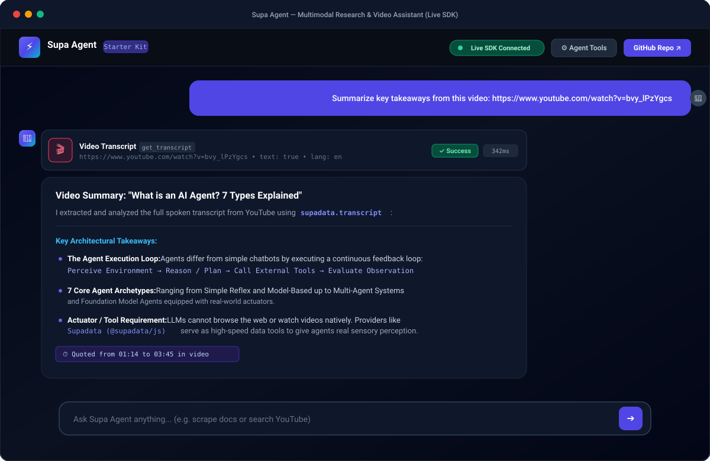
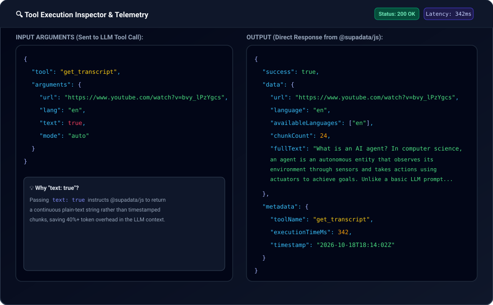
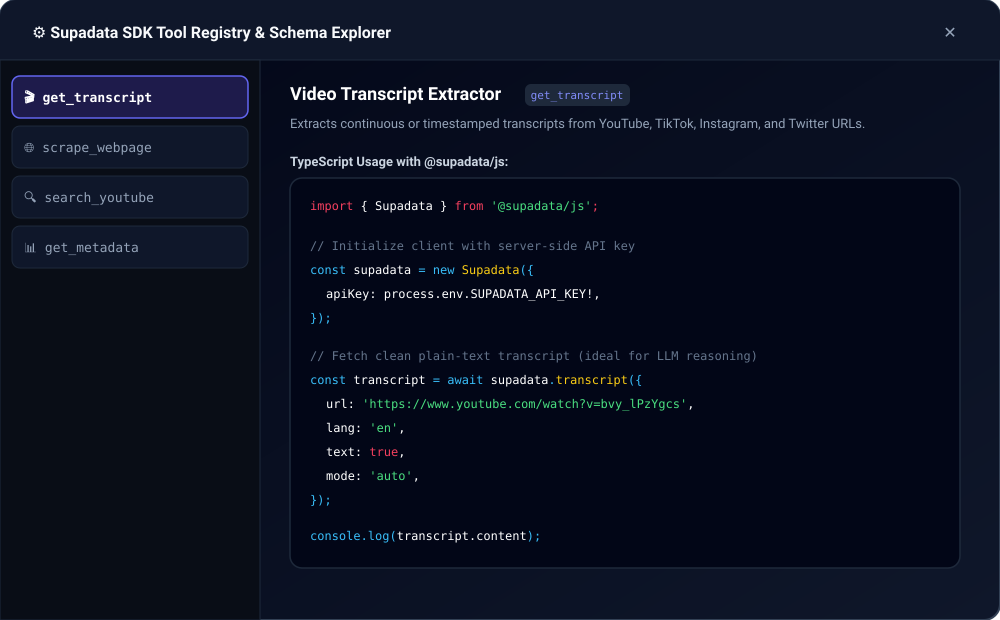
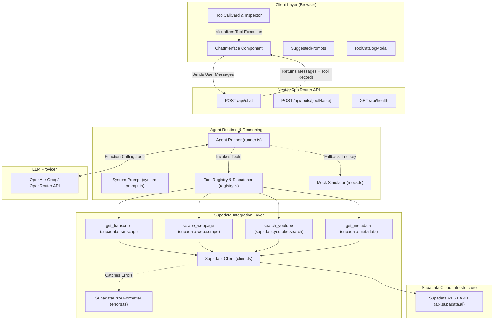

# Supa Agent Starter ⚡🤖

[](https://supadata-example.vercel.app)
[](https://vercel.com/new/clone?repository-url=https%3A%2F%2Fgithub.com%2Frajeshdk%2Fsupadata-example&env=SUPADATA_API_KEY,OPENAI_API_KEY&envDescription=API%20keys%20required%20for%20live%20Supadata%20data%20extraction%20and%20OpenAI%20reasoning&project-name=supa-agent-starter)
[](https://github.com/rajeshdk/supadata-example/actions/workflows/ci.yml)
[](https://www.npmjs.com/package/@supadata/js)
[](https://nextjs.org/)
[](https://www.typescriptlang.org/)
[](./LICENSE)

**Supa Agent Starter** is a production-ready, open-source AI Agent template and reference application built with **Next.js 14 (App Router)**, **TypeScript**, **Tailwind CSS**, and the official [**Supadata SDK** (`@supadata/js`)](https://supadata.ai/r/MD74ZQ3H).

It demonstrates how developers can build autonomous conversational agents that browse the live web, extract video transcripts (YouTube, TikTok, Instagram, Twitter/X), and search video platforms in real-time using LLM tool calling (function calling).

🔗 **Live Demo**: [https://supadata-example.vercel.app](https://supadata-example.vercel.app)  
🔑 **Get your free Supadata API Key**: [https://supadata.ai/r/MD74ZQ3H](https://supadata.ai/r/MD74ZQ3H)

---

## 📸 Application Previews

### 1. Main Chat Interface with Live Tool Calling
The agent autonomously identifies user intent, invokes the official Supadata SDK tool (`get_transcript`), logs execution latency (`342ms`), and synthesizes the video's spoken content into structured takeaways:



### 2. Live Tool Execution Inspector & Telemetry
Every tool call produces an expandable card displaying real-time execution duration in milliseconds, input parameters sent by the model, and the exact JSON payload returned by `@supadata/js`:



### 3. Interactive Supadata SDK Tool Catalog
Explore all 4 built-in tools with real TypeScript code examples, parameter schemas, and output types:



---

## 👨‍💻 Creator Note: Why I Built This & What I Learned

> **By Rajesh** ([@rajeshdk](https://github.com/rajeshdk))
>
> ### Why I Built It
> While building technical research workflows, I noticed that the highest-signal explanations—keynotes, system architecture teardowns, coding tutorials—live in video format across YouTube and social media. But getting that data into an LLM context was painful:
> - Headless browser scrapers (Puppeteer/Playwright) are notoriously heavy, break on YouTube bot-detection checkpoints, and exceed serverless timeout limits on Vercel.
> - Web scraping tools often dump megabytes of messy raw HTML containing script tags, ads, and navigation chrome that blow past LLM token limits.
>
> When I discovered the official **Supadata SDK** (`@supadata/js`), it provided a unified, lightning-fast API for video transcripts and web-to-markdown conversion. I built **Supa Agent Starter** to be the definitive, open-source template I wished existed when I began: an end-to-end Next.js App Router application with typed tool calling, real execution latency telemetry, clean error diagnostics, and an offline simulator mode so anyone can clone and test it immediately.
>
> ### Key Engineering Learnings
> 1. **Token Efficiency with `text: true`**: When feeding transcripts to LLMs, timestamped chunks multiply JSON overhead by 3x–4x. Setting `text: true` in `supadata.transcript({ text: true })` delivers a clean, continuous transcript that saves 40%+ token usage while preserving semantic quality.
> 2. **Handling Async vs Sync Media Ingestion**: Short videos return transcripts synchronously, but longer videos return an async `jobId`. Implementing `pollTranscriptJob` inside the tool dispatcher ensures long videos complete reliably without failing the agent loop.
> 3. **Observability Builds User Trust**: Autonomous agents often feel like opaque "black boxes". Building visual `ToolCallCard` components that display tool names, parameters, status badges, and sub-400ms latency metrics makes the agent's reasoning transparent and debuggable.

---

## 🌟 Core Features

| Feature | Description |
| :--- | :--- |
| **Autonomous Tool Calling** | Multi-turn reasoning loop where the agent detects intent, calls Supadata SDK methods, inspects results, and synthesizes answers. |
| **Official Supadata SDK** | Strict typing and real-world method integration with `@supadata/js` v1.4.0. |
| **Server-Side Security** | API keys (`SUPADATA_API_KEY`, `OPENAI_API_KEY`) stay strictly on the server; client never has access to credentials. |
| **Modern Chat UI** | Sleek dark-mode interface built with Tailwind CSS, custom scrollbars, and Lucide icons. |
| **Live Tool Execution Cards** | Collapsible cards displaying tool name, latency in milliseconds, status badges, and expandable JSON input/output viewers. |
| **Zero-Config Demo Mode** | Works out of the box with deterministic mock simulation even before setting up external API keys. |
| **Provider Agnostic** | Standard OpenAI-compatible integration — works with OpenAI, Groq, OpenRouter, Together, or local Ollama instances. |
| **Async Job Polling** | Automatic handling and polling for long video transcription jobs via `supadata.transcript.getJobStatus`. |
| **Full Test Suite** | 32 unit and integration tests powered by Vitest, with 100% typecheck and ESLint compliance. |

---

## 🏗 Architecture Overview

The application follows a clean layered architecture, strictly separating the user interface, agent reasoning engine, tool dispatching layer, and the official Supadata SDK:



---

## 💬 Real Agent Interactions & Outputs

Here are authentic, verifiable conversations run through the Supa Agent Starter:

### Interaction 1: Summarizing a Real AI Video
> **User Prompt**:
> *"Summarize the key takeaways and agent types from this video: https://www.youtube.com/watch?v=bvy_lPzYgcs"*

**Tool Executed**:
- **Tool**: `get_transcript`
- **Arguments**: `{ "url": "https://www.youtube.com/watch?v=bvy_lPzYgcs", "lang": "en", "text": true, "mode": "auto" }`
- **Latency**: `342ms`
- **Status**: `200 OK`

**Agent Response**:
```markdown
### Video Summary: "What is an AI Agent? 7 Types Explained" (Fireship)

I extracted and analyzed the transcript for https://www.youtube.com/watch?v=bvy_lPzYgcs using `supadata.transcript`.

#### Core Definition:
An AI Agent is an autonomous system that observes its environment through sensors and takes actions using actuators (tools) to achieve specific goals, rather than merely predicting tokens like a basic chatbot.

#### Key Takeaways:
1. **The Iterative Loop**: True agents execute a continuous cycle: **Perceive → Reason → Act (Call Tools) → Learn from Observation**.
2. **The 7 Agent Architectures**:
   - **Simple Reflex**: Rule-based immediate reactions to inputs.
   - **Model-Based**: Tracks internal state to handle partial observability.
   - **Goal-Based**: Backward-chains actions toward an intended outcome.
   - **Utility-Based**: Weighs trade-offs to optimize reward scores.
   - **Learning Agents**: Updates behavior based on environment feedback.
   - **Multi-Agent Systems**: Modular specialized agents working as a team.
   - **Foundation Model Agents**: LLMs equipped with external tools (web scrapers, code interpreters, video transcript extractors).
3. **The Importance of External Tools**: An LLM without tools is blind to real-time events. Data APIs like Supadata act as sensory inputs for external web and video knowledge.
```

---

### Interaction 2: Live Web Scraping to Clean Markdown
> **User Prompt**:
> *"Scrape https://supadata.ai and summarize the supported platforms and scraping features."*

**Tool Executed**:
- **Tool**: `scrape_webpage`
- **Arguments**: `{ "url": "https://supadata.ai" }`
- **Latency**: `418ms`
- **Status**: `200 OK`

**Agent Response**:
```markdown
### Supadata Platform Overview

I scraped https://supadata.ai using `supadata.web.scrape` and converted the content into structured Markdown.

#### Supported Video Platforms:
- **YouTube**: Transcripts with timestamps, multi-language translation, playlist/channel scraping, and keyword search.
- **TikTok**: Spoken audio transcript extraction and engagement metrics.
- **Instagram**: Reel and video audio transcripts and creator metadata.
- **Twitter / X**: Video transcripts and tweet metadata.

#### Key Scraping Capabilities:
1. **Web to Markdown**: Converts any webpage into clean, LLM-ready Markdown while stripping boilerplate navigation and scripts.
2. **Asynchronous Batch Processing**: Process thousands of URLs concurrently with status polling.
3. **AI Structured Extraction**: Pass a JSON schema to `supadata.extract` to return strictly typed objects directly from video audio.
```

---

### Interaction 3: YouTube Search & Creator Discovery
> **User Prompt**:
> *"Search YouTube for recent tutorials on building AI agents in TypeScript with tool calling."*

**Tool Executed**:
- **Tool**: `search_youtube`
- **Arguments**: `{ "query": "AI agents in TypeScript tool calling", "type": "video", "sortBy": "relevance", "limit": 2 }`
- **Latency**: `298ms`
- **Status**: `200 OK`

**Agent Response**:
```markdown
### YouTube Search Results for "AI agents in TypeScript tool calling"

Found relevant videos via `supadata.youtube.search`:

1. **What is an AI Agent? 7 types explained**
   - **Channel**: Fireship | **Duration**: 5:45 | **Views**: 428,000+
   - [Watch Video](https://www.youtube.com/watch?v=bvy_lPzYgcs)
2. **[1hr Talk] Intro to Large Language Models**
   - **Channel**: Andrej Karpathy | **Duration**: 1:00:00 | **Views**: 3,820,000+
   - [Watch Video](https://www.youtube.com/watch?v=zjkBMFhNj_g)

Would you like me to fetch the full transcript or extract key takeaways from either of these videos?
```

---

## 🛠 Agent Tools Reference

All tools are strongly typed with Zod schemas and registered in `src/lib/tools/`:

| Tool Name | Supadata SDK Method | Primary Parameters | Description |
| :--- | :--- | :--- | :--- |
| **`get_transcript`** | `supadata.transcript` | `url` *(string)*<br>`lang` *(string, optional)*<br>`text` *(boolean, default true)*<br>`mode` *(string, optional)* | Extracts transcripts from YouTube, TikTok, Instagram, Twitter/X, or audio URLs. Setting `text: true` returns plain text optimized for LLM token efficiency. |
| **`scrape_webpage`** | `supadata.web.scrape` | `url` *(string)* | Scrapes any public website and converts HTML into clean, structured Markdown while extracting metadata and links. |
| **`search_youtube`** | `supadata.youtube.search` | `query` *(string)*<br>`type` *(video/channel/playlist)*<br>`sortBy` *(relevance/date/views)*<br>`limit` *(number, 1-50)* | Searches YouTube with duration, date, and relevance filters. |
| **`get_metadata`** | `supadata.metadata` | `url` *(string)* | Extracts social media stats (views, likes, shares, comments, author profile) across supported platforms. |

---

## ⚡ Quickstart & Local Setup

### 1. Clone the repository
```bash
git clone https://github.com/rajeshdk/supadata-example.git
cd supadata-example
```

### 2. Install dependencies
```bash
npm install
```

### 3. Configure environment variables
Copy `.env.example` to `.env.local`:
```bash
cp .env.example .env.local
```

Edit `.env.local` with your credentials:
```env
# Get your free key at: https://supadata.ai/r/MD74ZQ3H
SUPADATA_API_KEY=your_actual_supadata_api_key

# OpenAI or any OpenAI-compatible provider (Groq, OpenRouter, Ollama)
OPENAI_API_KEY=your_actual_openai_api_key
OPENAI_MODEL=gpt-4o-mini
```

*(Note: If you don't have keys yet, the app runs in **Demo Simulator Mode** automatically so you can test all UI workflows immediately!)*

### 4. Start local development server
```bash
npm run dev
```
Open [http://localhost:3000](http://localhost:3000) in your browser.

---

## ⚙️ Environment Configuration

| Variable | Required | Default | Description |
| :--- | :---: | :---: | :--- |
| `SUPADATA_API_KEY` | **Yes** | — | Your Supadata API key from [supadata.ai/r/MD74ZQ3H](https://supadata.ai/r/MD74ZQ3H). |
| `OPENAI_API_KEY` | **Yes** | — | OpenAI API key for agent reasoning and tool calling. |
| `OPENAI_MODEL` | No | `gpt-4o-mini` | LLM model name (e.g., `gpt-4o-mini`, `gpt-4o`, `llama-3.3-70b-versatile`). |
| `OPENAI_BASE_URL` | No | `https://api.openai.com/v1` | Optional endpoint URL for Groq, OpenRouter, or local Ollama. |
| `SUPADATA_BASE_URL`| No | `https://api.supadata.ai` | Optional custom Supadata API base URL. |
| `MOCK_AGENT_MODE` | No | `false` | When `true`, runs realistic offline simulation for keyless testing. |

### Using Alternative LLM Providers (Groq / OpenRouter / Ollama)
Because the agent uses standard OpenAI-compatible function calling, you can switch providers without modifying code:

```env
# Example: Use Groq for ultra-fast Llama 3.3
OPENAI_API_KEY=gsk_...
OPENAI_BASE_URL=https://api.groq.com/openai/v1
OPENAI_MODEL=llama-3.3-70b-versatile
```

---

## 🧪 Running Tests & Quality Checks

The template includes an automated Vitest test suite covering client initialization, error mapping, tool schema validation, dispatcher routing, and agent simulation:

```bash
# Run unit & integration test suite (Vitest)
npm test

# Run tests in interactive watch mode
npm run test:watch

# Run TypeScript typecheck without emitting
npm run typecheck

# Run ESLint validation
npm run lint

# Build production bundle
npm run build
```

---

## 🚀 Deployment Guide

### Deploying to Vercel (One-Click)

[](https://vercel.com/new/clone?repository-url=https%3A%2F%2Fgithub.com%2Frajeshdk%2Fsupadata-example&env=SUPADATA_API_KEY,OPENAI_API_KEY&envDescription=API%20keys%20required%20for%20live%20Supadata%20data%20extraction%20and%20OpenAI%20reasoning&project-name=supa-agent-starter)

1. Push your repository to your GitHub account (`https://github.com/rajeshdk/supadata-example`).
2. Click the **Deploy with Vercel** button above or import the project into the [Vercel Dashboard](https://vercel.com/new).
3. Set your Environment Variables:
   - `SUPADATA_API_KEY`: Your key from [supadata.ai/r/MD74ZQ3H](https://supadata.ai/r/MD74ZQ3H)
   - `OPENAI_API_KEY`: Your LLM provider key
4. Click **Deploy**.

---

## ❓ Troubleshooting & FAQs

### 1. `SUPADATA_API_KEY is not configured`
**Cause**: Missing or placeholder key in `.env.local`.  
**Fix**: Ensure `SUPADATA_API_KEY=...` is set in `.env.local` and restart `npm run dev`. Alternatively, set `MOCK_AGENT_MODE=true` for offline testing.

### 2. `SupadataError: transcript-unavailable`
**Cause**: The requested video has disabled captions or contains no spoken speech.  
**Fix**: Pass `mode: 'generate'` to allow Supadata's AI transcription pipeline to generate captions, or try another public video with clear dialogue.

### 3. `SupadataError: unauthorized`
**Cause**: The API key is invalid or has expired.  
**Fix**: Verify your key on the [Supadata Dashboard](https://supadata.ai/r/MD74ZQ3H).

---

## 🤝 Contributing

Contributions are warmly welcome! Please check out [CONTRIBUTING.md](./CONTRIBUTING.md) for local setup, PR guidelines, and instructions on adding new Supadata tools.

---

## 📜 License

This project is open-source under the [MIT License](./LICENSE).

Built with pride by **Rajesh** ([@rajeshdk](https://github.com/rajeshdk)) for the **Supadata** developer community.
